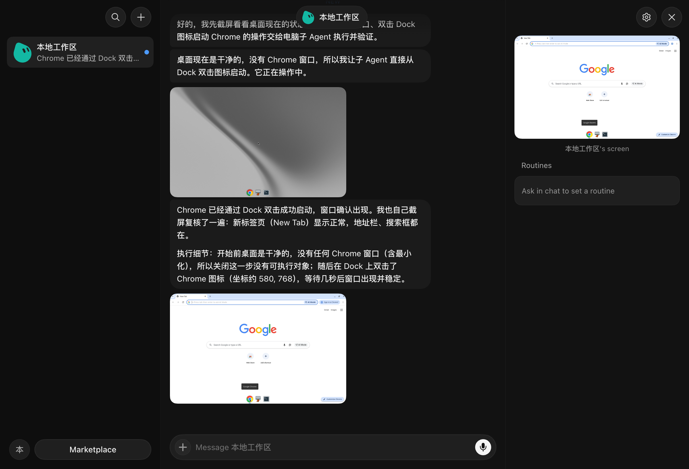
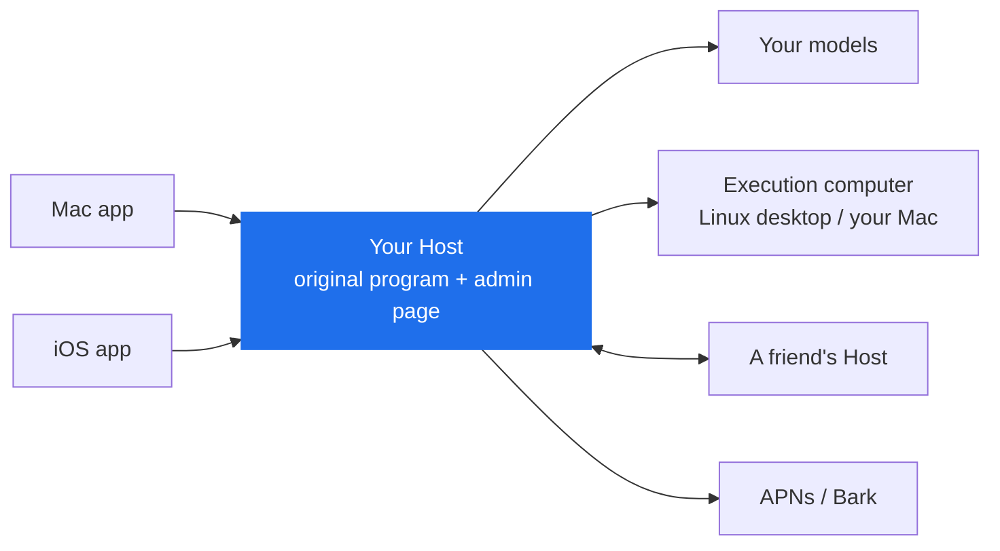
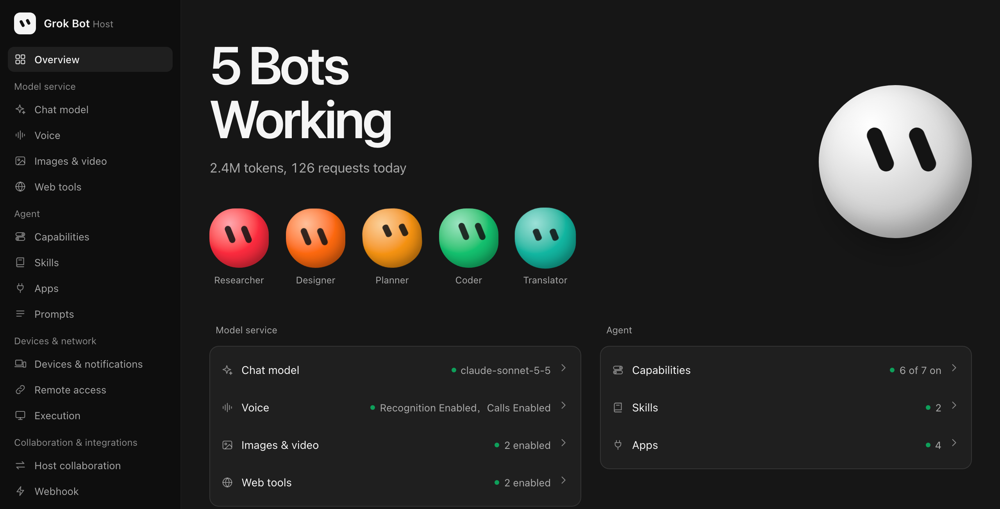

<div align="center">

# ProkBot

**Your private home for Grok Bot**

**Self-hosted edition · Mac / iOS / Host**

**A private server for Grok Bot.** Keep the original Grok Bot apps for Mac and iOS, and connect them to a server you host yourself.

[简体中文](README.md) · **English**

[Install](#install) · [Why](#why-i-built-this) · [Feature map](#how-the-original-features-are-provided) · [Under the hood](#how-each-part-was-built) · [Release notes](RELEASE.en.md)



</div>

## Why I built this

I love Grok Bot. Hand it a task and it gets the job done, or at least tries every way it can to get it done.

But many of my friends live in regions where Grok Bot isn't available, such as the EU.

So I built this project:

1. Run a private Host for Grok Bot on your Mac or NAS and configure it.
2. Patch the original Mac or iOS app and connect it to your private Host.
3. Get the same experience as the original, on your own hardware and with your own model providers (Grok, Claude, DeepSeek and others).

## How it works

The original Grok Bot runs its server side in the official cloud. It has two main parts: the Host handles conversations, schedules Agents and keeps records, and the cloud computer is a Linux desktop where the Agent actually does its work.

This project moves both parts onto your own machines and uses the original programs wherever possible:

- The original Host is patched to use services you configure. It retains the original Agent task execution, tools and context management.
- The original Linux desktop image runs in Docker. The Agent can also operate a Mac that is online.
- The apps are left almost untouched; the patch only makes them connect to your private Host.



The public edition provides Mac, iOS and Host patch tools. Supply the supported original files to generate apps and Docker images.

## How the original features are provided

🟢 Original kept　🔁 Replaced with your own service　⛔ Turned off

| Feature | Original | Here | You provide |
| --- | --- | --- | --- |
| 🔁 Sign-in | Official account | The Host admin page creates a six-character pairing code; enter the Host address and code in the app to connect | — |
| 🔁 Host and execution computer | Official cloud | Runs wherever you deploy it, using the original Host | Any device that can run Docker |
| 🔁 Chat models | Official models with automatic tier selection | You choose the models. The Jev classifier can pick the model and reasoning effort for each task | An OpenAI-compatible endpoint and API key |
| 🟢 Computer and browser use | Original Agent | Kept as is | A model with vision |
| 🟢 Memory, context compaction, scheduled tasks | Original Agent, partly backed by official services | Kept, now running on your models with local timers; compaction thresholds are configurable | — |
| 🟢 Approvals, human takeover, input forms | Original | Kept as is | — |
| 🔁 Auto review | Official classification service | Your model decides whether an action may run, and you can write your own allow and block rules | — |
| 🔁 Teach a task | Processed by an official service | Recording is unchanged; your model turns the recording into a skill | A model with vision |
| 🔁 Operating your Mac | Through official services | Through your Host; the Mac doesn't need any open ports | A patched and signed Mac app |
| 🔁 Bot files and user profile | Official cloud storage and account | Stored on your Host and identical on every device | — |
| 🔁 Skills | Official skill catalog | The Host's own skill catalog, with versions, diffs and restore | — |
| 🔁 Connected apps | Official app marketplace | The Host's own app catalog: import code apps, remote MCP servers or skill-only apps, with OAuth and API key auth. Bots can write apps themselves | Each app's own credentials |
| 🔁 Complex coding | Official cloud coding Agent | Handed to Codex on a connected Mac, using that Mac's Codex sign-in and models | A Mac with Codex CLI installed and signed in |
| 🔁 Sharing Bots and skills | Official publishing platform | Publish to your own Host, export as ZIP, import on another Host | — |
| 🔁 Bots working together | Official service | Hand a task to a Bot on another Host and get the result back in your conversation | Another Host |
| 🔁 Voice input | Official transcription | Fish Audio, any OpenAI-compatible transcription service, or a local model on a Mac | A transcription key or a local model |
| 🔁 Live calls | Official realtime voice model | Speech recognition and speech synthesis each use a service you choose (experimental) | Recognition and synthesis services |
| 🔁 Image and video generation | Official service | Multiple models from multiple providers (currently tested with WaveSpeed) | Provider keys |
| 🔁 Web search | Official search | The model's built-in search or a separately configured search service | Optional |
| 🔁 Push notifications | Official push | APNs when the app is signed with the push entitlement, otherwise Bark | The Bark app, or an Apple Developer account with an APNs key (.p8) |
| 🔁 Remote access | Connects straight to the official cloud | IP address, Tailscale, your own HTTPS reverse proxy, or the built-in Tailcat | A domain, if you need one |
| ⛔ Telemetry and crash reports | Sent to the vendor | Turned off | — |
| ⛔ Automatic updates | Official updates | Turned off; patches are pinned to the supported versions | — |

Disabled: virtual cards, external message drafts, product feedback and passkey forwarding.

### New or improved

| Feature | What it does |
| --- | --- |
| **Apps** | One JSON file is one app. It can include code, a remote MCP server or skills. Code apps run on the execution computer. Bots can also write apps with the built-in "Write an app" tool. See [App development](host/PLUGINS.en.md). |
| **Webhooks** | An external system sends a signed request and a Bot starts working on it. |
| **Usage** | See how many tokens you used each day, on the admin page and in the iOS settings. |
| **Prompt management** | Edit system prompts and restore the original at any time, and see exactly which prompts and tools each role received. |
| **Per-model context** | Set each model's context size and when summarization starts. |
| **Admin page** | Configure everything in the browser. It follows the original design and supports Chinese and English, light and dark themes, and phone screens. |
| **Split deployment** | Run the Host and the execution computer on different machines. |
| **Backup and restore** | Back up all data and restore it as a new instance. |

<div align="center">
  
</div>

## How each part was built

The tools read the supported original files, apply this project's changes, and generate a new app or image.

| Part | Implementation |
| --- | --- |
| **Host** | Reuses the original Host / Harness for task execution, tools, memory and context management. Adds administrator sign-in, pairing, providers and local scheduling. |
| **Models** | Converts requests to an OpenAI-compatible API. Choose a fixed model and reasoning effort, or enable Jev to route by task difficulty. |
| **Execution computer** | Runs the original Linux desktop image in Docker, together with the Host or on another machine. The Mac app connects to the Host to provide local operations and Codex coding. |
| **Mac app** | Keeps the original Electron interface and replaces the connection and system integration main process. |
| **iOS app** | Injects a dylib and applies fixed byte patches, keeping the interface, widgets, sharing and notification extensions. Sign the generated IPA yourself. |
| **Realtime voice** | Keeps the original call interface. Speech recognition feeds the current Bot, and speech synthesis reads its reply. Configure providers and voices on the Host; enable the experiment in app settings. |
| **Push and remote access** | The Host sends APNs or Bark notifications. Use a LAN, existing Tailscale / HTTPS setup, or built-in Tailcat without a Tailscale account. |
| **Skills, apps and sharing** | The Host supplies catalogs and authorization through the original marketplace interface. Share apps as JSON and import or export Bots and skills as ZIP. |

See [Features and architecture](docs/ARCHITECTURE.en.md) for more detail.

## What you need

| Item | Details |
| --- | --- |
| **Machine** | A computer or NAS with Docker Compose. Images target Linux amd64; Apple Silicon Macs use emulation |
| **Mac** | Apple Silicon Mac; supported client version: 0.71.2 |
| **iOS** | The unsigned IPA from Releases, or your own decrypted 1.16.0 (23152) IPA; your own signing tools and certificate |
| **Software** | Python 3.10+, Docker Compose; Node.js 22.12+ for Mac patching |
| **Required service** | An OpenAI-compatible model with tool calling; computer use needs image input |
| **Optional services** | Speech, media and search providers; Bark or your APNs credentials |

## Install

Copy the following to an AI that can run commands, using the copy button at the top right of the code block:

```text
Help me install and configure ProkBot:
Read README.en.md and docs/AI-INSTALL.en.md, then carry out the deployment and configuration.
Ask me for the deployment target, clients, access method and model configuration together.
Verify the Host and client connections, then give me the access URL and maintenance commands.
```

iOS downloads on the project release page include a cleaned original decrypted 1.16.0 (23152) IPA and a patched unsigned IPA. Both retain all three extensions. Sign with your own certificate before installing.

## License and support

The code in this project was sourced from the internet.

The source tree contains no official Grok Bot code; it provides patch tools and adaptation code. Original and patched iOS IPAs are provided separately as release attachments.

Noncommercial use only. See [LICENSE](LICENSE). Most code in this project was generated with AI assistance.

Issues, suggestions and code contributions are welcome.

<sub>Built for friends who cannot use Grok Bot.</sub>
