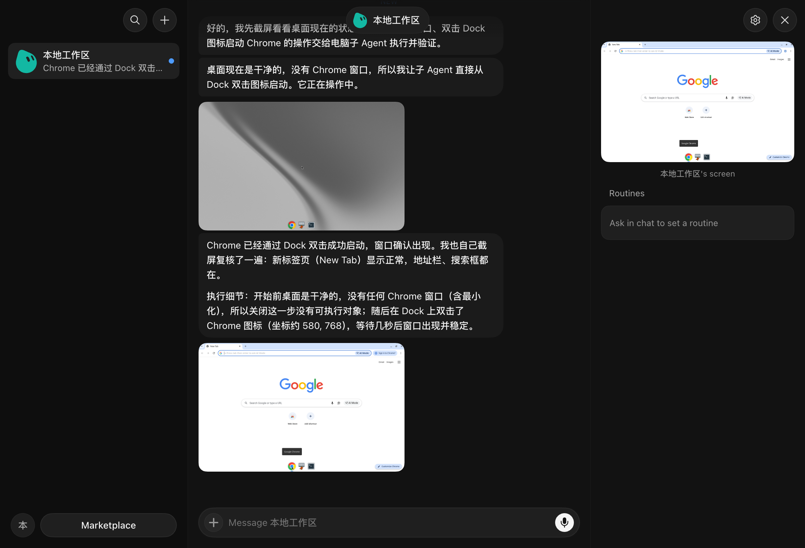
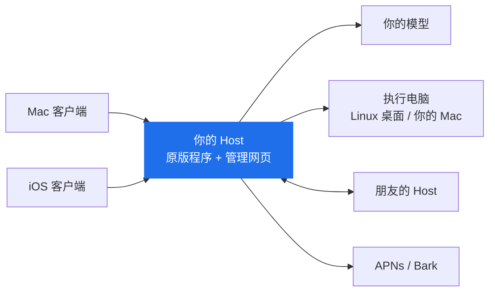
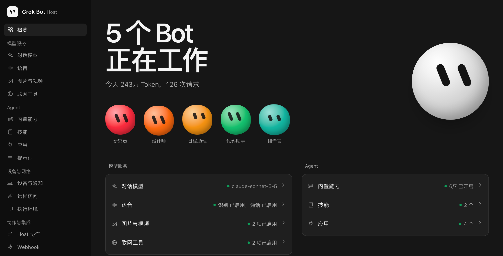

<div align="center">

# ProkBot

**Your private home for Grok Bot**

**自部署版 · Mac / iOS / Host**

**一个 Grok Bot 私服。** 使用原版 Grok Bot 的 Mac 和 iOS 客户端，连接自部署服务端。

**简体中文** · [English](README.en.md)

[安装](#安装) · [为什么做这个](#为什么做这个) · [功能对照](#如何实现原生功能) · [实现思路](#每个部分是怎么做的) · [发布说明](RELEASE.md)



</div>

## 为什么做这个

我很喜欢 Grok Bot，交给它一件事，它会帮你干好，或者说，想尽办法帮你做好。

所以我做了这个项目。

1. 在你的 Mac 或 NAS 上运行一个给 Grok Bot 用的私有服务器 Host，并完成配置。
2. 使用补丁生成 Mac 或 iOS 客户端，让它连到你的私有 Host。
3. 体验和原版一样，但使用你自己的设备和推理服务（Grok、Claude、DeepSeek 等）。

## 原理

原版 Grok Bot 的服务端在官方云端，主要有两部分：Host 负责对话、调度 Agent 和保存记录；云电脑是一台 Linux 桌面，Agent 在上面实际操作。

这个项目把这两部分都搬到你自己的机器上，尽量直接使用原版程序：

- 对原始 Host 进行 Patch，使其使用你自己配置的服务。保留原版 Agent 的任务执行、工具调用和上下文管理。
- 使用原始 Linux 桌面镜像，运行在 Docker 里。让 Agent 直接操作在线 Mac 也可用。
- 客户端几乎保持不变，Patch 使其可以连接你的私有 Host。



提供 Mac、iOS、Host 三个补丁工具；使用指定版本的原文件生成客户端与 Docker 镜像。

## 如何实现原生功能

🟢 保留原版　🔁 换成你自己的服务　⛔ 已关闭

| 功能 | 原版 | 这里 | 你需要准备 |
| --- | --- | --- | --- |
| 🔁 登录 | 官方账号 | Host 管理页生成六位配对码，客户端输入 Host 地址和配对码即可连接 | — |
| 🔁 Host 和执行电脑 | 官方云端 | 运行在你部署的位置，使用原版 Host | 一台能运行 Docker 的任意设备 |
| 🔁 对话模型 | 官方模型，自动选择等级 | 自行决定模型。可以让 Jev 分类器自动选择使用的模型和思考强度 | OpenAI 兼容接口的地址和 API Key |
| 🟢 电脑和浏览器操作 | 原版 Agent | 保留原版 | 支持视觉能力的模型 |
| 🟢 记忆、上下文压缩、定时任务 | 原版 Agent，部分依赖官方服务 | 保留原版，改用你的模型和本地计时，上下文压缩可自行设置 | — |
| 🟢 操作审批、人工接管、交互表单 | 原版 | 保留原版 | — |
| 🔁 自动审查 | 官方分类服务 | 用你的模型判断操作能不能执行，允许和阻止规则可以自己写 | — |
| 🔁 演示任务（Teach a task） | 官方服务整理 | 录制保留原版，整理成技能用你的模型 | 支持视觉能力的模型 |
| 🔁 操作你的 Mac | 经官方服务 | 经你的 Host，Mac 不需要开放端口 | Patch 后签名的 Mac 客户端 |
| 🔁 Bot 资料库、用户资料 | 官方云存储和账号 | 保存在 Host 上，所有设备看到的一样 | — |
| 🔁 技能 | 官方技能目录 | Host 自己的技能目录，可以查看版本、对比和恢复 | — |
| 🔁 连接应用 | 官方应用市场 | Host 自己的应用目录，可以导入代码应用、远程 MCP 或纯技能，支持 OAuth、API Key 授权；Bot 也能自己编写应用 | 应用自己的凭据 |
| 🔁 复杂编程 | 官方云端编程 Agent | 交给已连接 Mac 上的 Codex，使用这台 Mac 的 Codex 登录和模型 | 安装并登录 Codex CLI 的 Mac |
| 🔁 Bot 和技能分享 | 官方发布平台 | 发布到自己的 Host，可导出 ZIP，在别的 Host 导入 | — |
| 🔁 多个 Bot 协作 | 官方服务 | 把任务交给其他 Host 上的 Bot，结果回到你的对话 | 另一个 Host |
| 🔁 语音输入 | 官方转写 | Fish Audio、OpenAI 兼容的转写服务，或 Mac 上的本地模型 | 转写服务的 Key 或本地模型 |
| 🔁 实时通话 | 官方实时语音模型 | 识别和合成分别接你选的服务（实验功能） | 识别和合成服务 |
| 🔁 图片和视频生成 | 官方服务 | 多个供应商的多个模型（目前测试 Wavespeed） | 供应商的 Key |
| 🔁 联网搜索 | 官方搜索 | 用模型自带的搜索，或单独配置搜索服务 | 可选 |
| 🔁 手机推送 | 官方推送 | 安装包签名带推送权限时用 APNs，否则用 Bark | Bark App，或 Apple 开发者账号和 APNs 密钥（.p8） |
| 🔁 外网访问 | 直接连官方云端 | IP 地址、Tailscale 组网、自定义 HTTPS 反向代理，或内置的 Tailcat | 视情况准备域名 |
| ⛔ 遥测和错误上报 | 发给官方 | 已关闭 | — |
| ⛔ 自动更新 | 官方更新 | 已关闭，补丁固定在支持的版本 | — |

已关闭：虚拟卡、外部消息草稿、产品反馈与通行密钥转发。

### 新增或增强功能

| 功能 | 说明 |
| --- | --- |
| **应用** | 一个 JSON 文件就是一个应用，可以带代码、远程 MCP 服务或技能。代码应用运行在执行电脑上。Bot 也可以用内置的“编写应用”自己写应用。见[应用开发](host/PLUGINS.md)。 |
| **Webhook** | 外部系统发一个签名请求，Bot 就开始执行任务。 |
| **用量统计** | 每天用了多少 Token，在管理页和 iOS 设置里都能看到。 |
| **提示词管理** | 可以修改系统提示词并随时恢复原版，还能看到每个角色实际收到的提示词和工具。 |
| **按模型设置上下文** | 每个模型的容量和开始摘要的时机可以单独设置。 |
| **管理网页** | 所有设置都在浏览器里完成，沿用原版的设计风格，支持中英文、深浅色和手机屏幕。 |
| **分开部署** | Host 和执行电脑可以放在不同的机器上。 |
| **备份恢复** | 备份全部数据，恢复成一个新的实例。 |

<div align="center">
  
</div>

## 每个部分是怎么做的

补丁从指定版本的原文件中读取内容，加入本项目的修改，生成新的客户端或镜像。

| 部分 | 实现方式 |
| --- | --- |
| **Host** | 复用原 Host / Harness 的任务执行、工具、记忆和上下文管理，补充管理员登录、设备配对、供应商配置与本地定时触发。 |
| **模型** | 将原模型请求转换为 OpenAI 兼容接口。可以固定模型和思考强度，也可以启用 Jev，按任务难度选择模型与强度。 |
| **执行电脑** | 原 Linux 桌面镜像运行在 Docker 中，可以与 Host 分开部署。Mac 客户端主动连接 Host，提供本机操作与 Codex 编程。 |
| **Mac 客户端** | 保留 Electron 原界面，替换连接和系统功能的主进程，接入自己的 Host。 |
| **iOS 客户端** | 注入 dylib 并应用固定字节补丁，保留原界面、小组件、分享和通知扩展。输出的 IPA 自行签名安装。 |
| **实时语音** | 保留原通话界面；识别服务将语音转成文字，由当前 Bot 回答，再由合成服务朗读。供应商和音色在 Host 配置，实验开关在客户端设置。 |
| **推送与远程访问** | Host 发送 APNs 或 Bark 通知。可使用局域网、已有的 Tailscale / HTTPS，也可启用内置 Tailcat，无需 Tailscale 账号。 |
| **技能、应用与分享** | 目录和授权由 Host 提供，客户端沿用原市场界面。应用通过 JSON 分享，Bot 与技能通过 ZIP 导入导出。 |

更完整的说明见[功能与原理](docs/ARCHITECTURE.md)。

## 你需要准备什么

| 类别 | 内容 |
| --- | --- |
| **机器** | 支持 Docker Compose 的电脑或 NAS；镜像为 Linux amd64，Apple Silicon Mac 通过转译运行 |
| **Mac** | Apple Silicon Mac；支持的客户端版本为 0.71.2 |
| **iOS** | 使用发布页提供的未签名 IPA，或自行注入 1.16.0（23152）砸壳包；准备自己的签名工具和证书 |
| **软件** | Python 3.10+、Docker Compose；生成 Mac 客户端需要 Node.js 22.12+ |
| **必需服务** | 支持工具调用的 OpenAI 兼容模型接口；电脑操作需要模型支持图片输入 |
| **可选服务** | 语音、图片视频、搜索供应商；Bark 或自己的 APNs 凭据 |

## 安装

复制下面内容给能执行命令的 AI，点击代码框右上角即可复制：

```text
请帮我安装并配置 ProkBot：
先阅读 README.md 和 docs/AI-INSTALL.md，按指南实际完成部署与配置。
需要我提供的部署位置、客户端、访问方式和模型信息，请一次问清。
完成后验证 Host 和客户端连接，告诉我使用入口及日常维护命令。
```

iOS 安装包：项目发行页提供清理后的 1.16.0（23152）原版砸壳 IPA 和已注入的未签名 IPA，均保留三个扩展。使用自己的证书签名安装。

## 许可与支持

本项目代码来源于互联网。

本仓库源码部分不包含任何 Grok Bot 官方代码，仅提供补丁工具与适配代码。iOS 原版和已注入 IPA 在发行附件中单独提供。

仅限非商业使用，见 [LICENSE](LICENSE)。本项目多数代码由 AI 辅助生成。

欢迎提问题、提建议和提交代码。

<sub>为了那些用不了 Grok Bot 的朋友而做。</sub>
