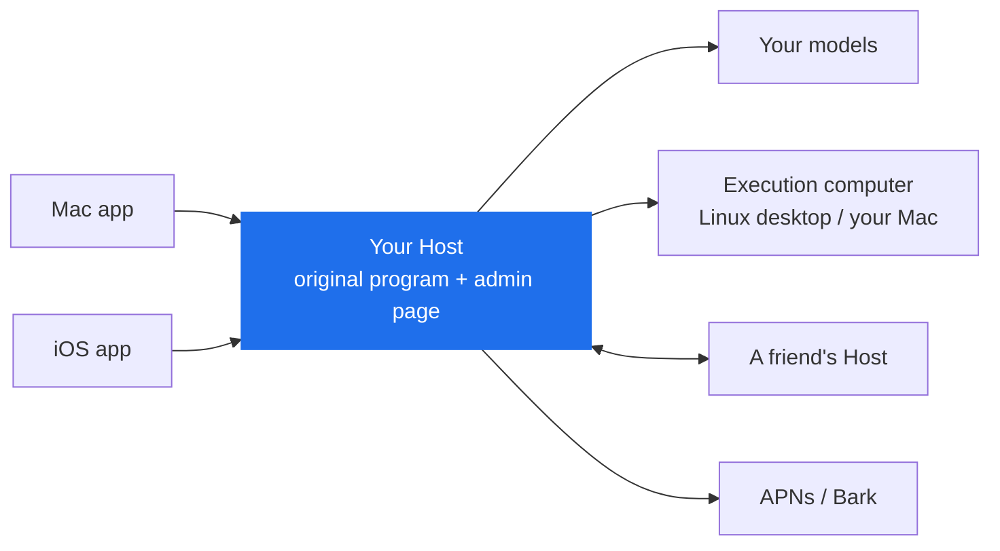
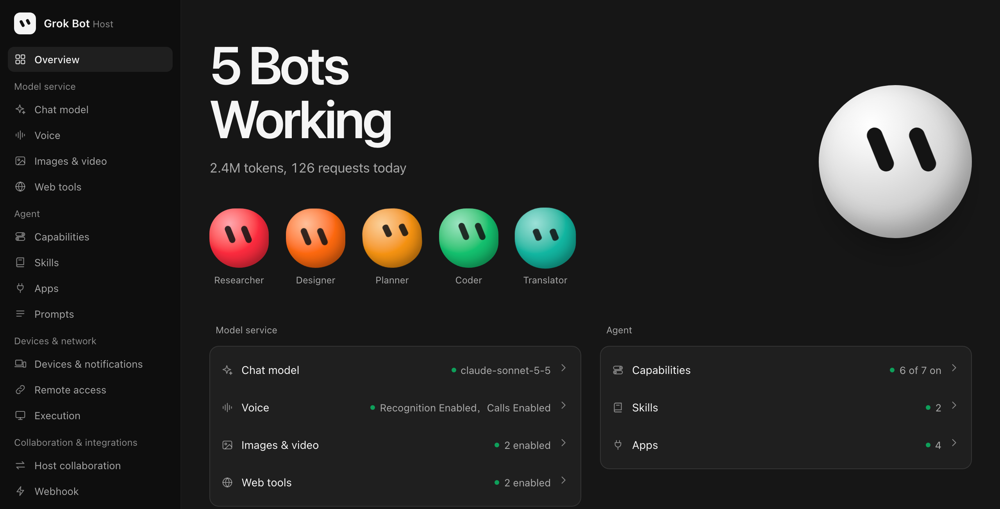

# Features and architecture

## How it works

The original Grok Bot runs its server side in the official cloud. It has two main parts: the Host handles conversations, schedules Agents and keeps records, and the cloud computer is a Linux desktop where the Agent actually does its work.

This project moves both parts onto your own machines and uses the original programs wherever possible:

- The original Host is patched to use services you configure. How the Agent thinks, calls tools and operates a computer stays exactly as it was.
- The original Linux desktop image runs in Docker. The Agent can also operate a Mac that is online.
- The apps are left almost untouched; the patch only makes them connect to your private Host.

The project ships three patch tools. Together they let you build and run your own private Grok Bot server.

## How the original features are provided

🟢 Original kept　🔁 Replaced with your own service　⛔ Turned off

| Feature | Original | Here | You provide |
| --- | --- | --- | --- |
| 🔁 Sign-in | Official account | No account needed. The Host admin page creates a six-character pairing code; enter the Host address and code in the app to connect | — |
| 🔁 Host and execution computer | Official cloud | Runs wherever you deploy it, using the original Host | Any device that can run Docker |
| 🔁 Chat models | Official models with automatic tier selection | You choose the models. The Jev classifier can pick the model and reasoning effort for each task | An OpenAI-compatible endpoint and API key |
| 🟢 Computer and browser use | Original Agent | Kept as is | A model with vision |
| 🟢 Memory, context compaction, scheduled tasks | Original Agent, partly backed by official services | Kept, now running on your models with local timers; compaction thresholds are configurable | — |
| 🟢 Approvals, human takeover, input forms | Original | Kept as is | — |
| 🔁 Auto review | Official classification service | Your model decides whether an action may run, and you can write your own allow and block rules | — |
| 🔁 Teach a task | Processed by an official service | Recording is unchanged; your model turns the recording into a skill | A model with vision |
| 🔁 Operating your Mac | Through official services | Through your Host; the Mac doesn't need any open ports | A patched and signed Mac app |
| 🔁 Bot files and user profile | Official cloud storage and account | Stored on your Host and identical on every device | — |
| 🔁 Skills | Official skill catalog | The Host's own skill catalog, with versions, diffs and restore | — |
| 🔁 Connected apps | Official app marketplace | The Host's own app catalog: import code apps, remote MCP servers or skill-only apps, with OAuth and API key auth. Bots can write apps themselves | Each app's own credentials |
| 🔁 Complex coding | Official cloud coding Agent | Handed to Codex on a connected Mac, using that Mac's Codex sign-in and models | A Mac with Codex CLI installed and signed in |
| 🔁 Sharing Bots and skills | Official publishing platform | Publish to your own Host, export as ZIP, import on another Host | — |
| 🔁 Bots working together | Official service | Hand a task to a Bot on another Host and get the result back in your conversation | Another Host |
| 🔁 Voice input | Official transcription | Fish Audio (recommended), any OpenAI-compatible transcription service, or a local model on a Mac | A transcription key or a local model |
| 🔁 Live calls | Official realtime voice model | Speech recognition and speech synthesis each use a service you choose (experimental) | Recognition and synthesis services |
| 🔁 Image and video generation | Official service | Multiple models from multiple providers (currently tested with WaveSpeed) | Provider keys |
| 🔁 Web search | Official search | The model's built-in search or a separately configured search service | Optional |
| 🔁 Push notifications | Official push | APNs when the app is signed with the push entitlement, otherwise Bark | The Bark app, or an Apple Developer account with an APNs key (.p8) |
| 🔁 Remote access | Connects straight to the official cloud | IP address, Tailscale, your own HTTPS reverse proxy, or the built-in Tailcat | A domain, if you need one |
| ⛔ Telemetry and crash reports | Sent to the vendor | Turned off | — |
| ⛔ Automatic updates | Official updates | Turned off; patches are pinned to the supported versions | — |

These original features aren't available yet: virtual cards, external message drafts, product feedback and passkey forwarding.

### New or improved

| Feature | What it does |
| --- | --- |
| **Apps** | One JSON file is one app. It can include code, a remote MCP server or skills. Code apps run on the execution computer and share its permissions and files with other tasks there. Bots can also write apps with the built-in "Write an app" tool. See [App development](../host/PLUGINS.en.md). |
| **Webhooks** | An external system sends a signed request and a Bot starts working on it. |
| **Usage** | See how many tokens you used each day, on the admin page and in the iOS settings. |
| **Prompt management** | Edit system prompts and restore the original at any time, and see exactly which prompts and tools each role received. |
| **Per-model context** | Set each model's context size and when summarization starts. |
| **Admin page** | Configure everything in the browser. It follows the original design and supports Chinese and English, light and dark themes, and phone screens. |
| **Split deployment** | Run the Host and the execution computer on different machines. |
| **Backup and restore** | Back up all data and restore it as a new instance. |

  

## How each part was built

### Patching

The tools copy what they need from the original files you provide and add our patch code. It takes a few seconds.

### Host

The original Host is a Node.js program. We didn't rewrite it. We replaced only the four parts tied to official services: authentication, Agent identity, model calls and MCP configuration. Scheduled tasks were triggered by the official backend, so we added local timers.

Around the original Host we wrote an admin service. It handles admin sign-in, device pairing, model and provider settings and push notifications, and forwards app requests to the original Host.

### Models

The original sends model requests to an official classifier, which decides which model to use (Grok most of the time). We take over just before the Host sends a request, convert the original message format to the OpenAI-compatible format, and convert the streamed reply back. Tool calls, sub-Agents and context management are still the original logic.

The original picks a model tier per task, and that decision happens on the official backend. Jev replaces it: it first judges how hard the task is, then hands it to the model for that tier.

### Execution computer

In the original, every user gets an official cloud computer. We use the same official Linux desktop image, running in your Docker, and the Host operates it over an authenticated connection. The execution computer can live on the same machine as the Host or on another one. When the Agent operates your Mac, the Mac app connects out to the Host, so the Mac doesn't need any open ports.

### Mac app

The original Mac app is built with Electron. We kept the original interface and rewrote the main process that handles connections and system features, so it only talks to your Host.

Complex coding tasks go to Codex on that Mac, using the Mac's own Codex sign-in and models. You can continue or cancel them.

The app is ad-hoc signed by default. To let the Agent operate this Mac, sign it with your own certificate.

### iOS app

The original iOS app is built with React Native. We wrote an injected dynamic library (Objective-C) that redirects requests meant for official servers to your Host, and we make a small set of fixed changes to the bytecode.

The original widget, share and notification extensions are kept, each with its own bundle ID. The patch produces an unsigned IPA; sign the main app and all three extensions yourself before installing.

### Voice

Live calls in the original use an official realtime voice model. We kept the original call screen, microphone and playback logic and turned the conversation into three steps: a recognition service turns your speech into text, the current Bot answers with its own model, context and tools, and a synthesis service reads the answer aloud.

### Push and remote access

The Host can send notifications through the Apple Push Notification service (APNs) directly. That needs an Apple Developer account with push capability and a .p8 push key. Without one, you can use Bark.

You can reach the Host on your local network only, or through a VPN or an HTTPS reverse proxy. The easiest option is the built-in Tailcat.

Tailcat is an open-source networking component from Tailscale. We built it into the apps, the Host and the execution computer. Copy the connection link or scan the QR code to connect; no Tailscale sign-in is needed.

### Skills, apps, sharing and collaboration

In the original, the skill catalog, the app marketplace, Bot template publishing and multi-Agent collaboration all depend on the official platform.

We built our own version of each on the Host and kept the original interface wherever possible: the marketplace list, the skill publishing menu and the Bot publishing card are all the original screens, now backed by your Host.

Code apps and webhooks are new, and they plug into the original tools and automations.

Friends can share Bots with each other.
