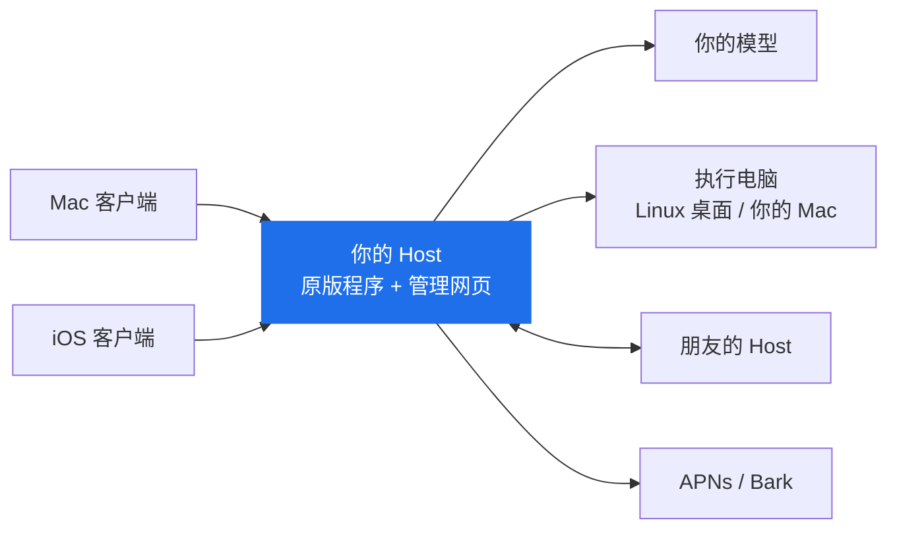
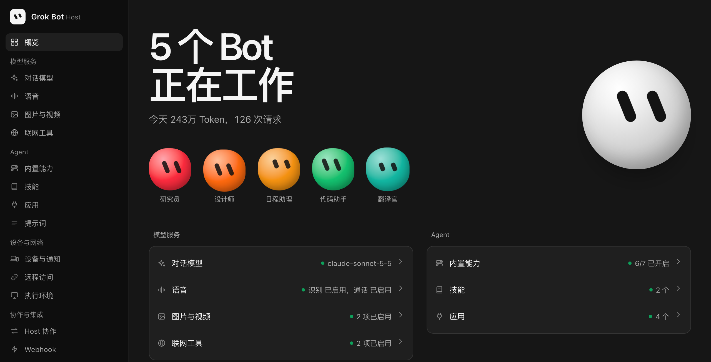

# 功能与原理

## 原理

原版 Grok Bot 的服务端在官方云端，主要有两部分：Host 负责对话、调度 Agent 和保存记录；云电脑是一台 Linux 桌面，Agent 在上面实际操作。

这个项目把这两部分都搬到你自己的机器上，尽量直接使用原版程序：

- 对原始 Host 进行 Patch，使其使用你自己配置的服务。Agent 思考、工具调用、操作电脑，保持原版。
- 使用原始 Linux 桌面镜像，运行在 Docker 里。让 Agent 直接操作在线 Mac 也可用。
- 客户端几乎保持不变，Patch 使其可以连接你的私有 Host。

本项目提供三个 Patch 工具，用它们可以搭建并使用私有的 Grok Bot 服务器。

## 如何实现原生功能

🟢 保留原版　🔁 换成你自己的服务　⛔ 已关闭

| 功能 | 原版 | 这里 | 你需要准备 |
| --- | --- | --- | --- |
| 🔁 登录 | 官方账号 | 不需要账号。Host 管理页生成六位配对码，客户端输入 Host 地址和配对码即可连接 | — |
| 🔁 Host 和执行电脑 | 官方云端 | 运行在你部署的位置，使用原版 Host | 一台能运行 Docker 的任意设备 |
| 🔁 对话模型 | 官方模型，自动选择等级 | 自行决定模型。可以让 Jev 分类器自动选择使用的模型和思考强度 | OpenAI 兼容接口的地址和 API Key |
| 🟢 电脑和浏览器操作 | 原版 Agent | 保留原版 | 支持视觉能力的模型 |
| 🟢 记忆、上下文压缩、定时任务 | 原版 Agent，部分依赖官方服务 | 保留原版，改用你的模型和本地计时，上下文压缩可自行设置 | — |
| 🟢 操作审批、人工接管、交互表单 | 原版 | 保留原版 | — |
| 🔁 自动审查 | 官方分类服务 | 用你的模型判断操作能不能执行，允许和阻止规则可以自己写 | — |
| 🔁 演示任务（Teach a task） | 官方服务整理 | 录制保留原版，整理成技能用你的模型 | 支持视觉能力的模型 |
| 🔁 操作你的 Mac | 经官方服务 | 经你的 Host，Mac 不需要开放端口 | Patch 后签名的 Mac 客户端 |
| 🔁 Bot 资料库、用户资料 | 官方云存储和账号 | 保存在 Host 上，所有设备看到的一样 | — |
| 🔁 技能 | 官方技能目录 | Host 自己的技能目录，可以查看版本、对比和恢复 | — |
| 🔁 连接应用 | 官方应用市场 | Host 自己的应用目录，可以导入代码应用、远程 MCP 或纯技能，支持 OAuth、API Key 授权；Bot 也能自己编写应用 | 应用自己的凭据 |
| 🔁 复杂编程 | 官方云端编程 Agent | 交给已连接 Mac 上的 Codex，使用这台 Mac 的 Codex 登录和模型 | 安装并登录 Codex CLI 的 Mac |
| 🔁 Bot 和技能分享 | 官方发布平台 | 发布到自己的 Host，可导出 ZIP，在别的 Host 导入 | — |
| 🔁 多个 Bot 协作 | 官方服务 | 把任务交给其他 Host 上的 Bot，结果回到你的对话 | 另一个 Host |
| 🔁 语音输入 | 官方转写 | Fish Audio（推荐）、OpenAI 兼容的转写服务，或 Mac 上的本地模型 | 转写服务的 Key 或本地模型 |
| 🔁 实时通话 | 官方实时语音模型 | 识别和合成分别接你选的服务（实验功能） | 识别和合成服务 |
| 🔁 图片和视频生成 | 官方服务 | 多个供应商的多个模型（目前测试 Wavespeed） | 供应商的 Key |
| 🔁 联网搜索 | 官方搜索 | 用模型自带的搜索，或单独配置搜索服务 | 可选 |
| 🔁 手机推送 | 官方推送 | 安装包签名带推送权限时用 APNs，否则用 Bark | Bark App，或 Apple 开发者账号和 APNs 密钥（.p8） |
| 🔁 外网访问 | 直接连官方云端 | IP 地址、Tailscale 组网、自定义 HTTPS 反向代理，或内置的 Tailcat | 视情况准备域名 |
| ⛔ 遥测和错误上报 | 发给官方 | 已关闭 | — |
| ⛔ 自动更新 | 官方更新 | 已关闭，补丁固定在支持的版本 | — |

原版的这些功能目前没有提供：虚拟卡、外部消息草稿、产品反馈和通行密钥转发。

### 新增或增强功能

| 功能 | 说明 |
| --- | --- |
| **应用** | 一个 JSON 文件就是一个应用，可以带代码、远程 MCP 服务或技能。代码应用运行在执行电脑上，和这台电脑上的其他任务共享权限和文件。Bot 也可以用内置的“编写应用”自己写应用。见[应用开发](../host/PLUGINS.md)。 |
| **Webhook** | 外部系统发一个签名请求，Bot 就开始执行任务。 |
| **用量统计** | 每天用了多少 Token，在管理页和 iOS 设置里都能看到。 |
| **提示词管理** | 可以修改系统提示词并随时恢复原版，还能看到每个角色实际收到的提示词和工具。 |
| **按模型设置上下文** | 每个模型的容量和开始摘要的时机可以单独设置。 |
| **管理网页** | 所有设置都在浏览器里完成，沿用原版的设计风格，支持中英文、深浅色和手机屏幕。 |
| **分开部署** | Host 和执行电脑可以放在不同的机器上。 |
| **备份恢复** | 备份全部数据，恢复成一个新的实例。 |

  

## 每个部分是怎么做的

### 补丁方式

从你提供的原版文件里复制内容，加入我们的 Patch 代码，几秒钟就能完成。

### Host

原版 Host 是一个 Node.js 程序。我们没有重写它，只替换了四个和官方服务绑定的部分：身份验证、Agent 身份、模型调用和 MCP 配置。原版的定时任务由官方后端触发，我们补上了本地计时。

在原版 Host 外面，我们写了一个管理服务，负责管理员登录、设备配对、模型和各种供应商的配置、推送，再把客户端的请求转给原版 Host。

### 模型

原版的模型请求发给官方分类器，由官方决定用哪个模型（大部分时间是 Grok）。我们在 Host 发出请求前接手，把原版的消息格式转换成 OpenAI 兼容格式，再把模型的流式回复转换回来。工具调用、子 Agent 和上下文管理仍然是原版逻辑。

原版会按任务自动选择模型等级，这一步原本在官方后端完成。我们使用 Jev 来代替：先判断任务难度，再交给对应等级的模型。

### 执行电脑

原版每个用户有一台官方云电脑。我们直接使用同一个官方 Linux 桌面镜像，在你的 Docker 里运行，Host 通过带认证的连接操作它。执行电脑可以和 Host 放在同一台机器，也可以放到另一台。想让 Agent 操作你的 Mac 时，Mac 客户端会主动连到 Host，所以 Mac 不需要开放任何端口。

### Mac 客户端

原版 Mac 客户端是 Electron 应用。我们保留原版界面，重写了负责连接和系统功能的主进程，让它只连接你的 Host。

复杂的编程任务会交给这台 Mac 上的 Codex，用的是 Mac 本机的 Codex 登录和模型，可以继续或取消。

默认使用 ad-hoc 签名，想让 Agent 操作这台 Mac，需要用自己的证书签名。

### iOS 客户端

原版 iOS 客户端用 React Native 开发。我们写了一个注入的动态库（Objective-C），把原本发往官方的请求转到你的 Host；再对字节码做少量固定修改。

原版的小组件、分享和通知三个扩展也保留了下来，使用独立的 Bundle ID。补丁输出未签名的 IPA，主应用和三个扩展都需要你自己签名后安装。

### 语音

实时通话用的是官方的实时语音模型。我们保留原版的通话界面、麦克风和播放逻辑，把对话改成三步：识别服务把你的话转成文字，当前 Bot 用自己的模型、上下文和工具回答，再由合成服务读出来。

### 推送和外网访问

Host 直接可以给 Apple 推送服务（APNs）发通知，这需要有推送权限的 Apple 开发者账号，并配置 .p8 推送密钥；没有的话可以用 Bark 推送。

访问 Host 可以仅局域网、或使用 VPN、配置 HTTPS 反向代理等，最方便的是使用内置的 Tailcat。

Tailcat 是 Tailscale 开源的组网组件，我们把它内置到了客户端、Host 和执行电脑里，复制连接链接或扫码即可连接，不需要登录 Tailscale。

### 技能、应用、分享和协作

原版的技能目录、应用市场、Bot 模板发布和多 Agent 协作都依赖官方平台。

我们在 Host 上各做了一份，并尽量沿用原版界面：应用市场的列表、技能的发布菜单、Bot 的发布卡片都是原版界面，只是数据来自你的 Host。

代码应用和 Webhook 是新增的，接入了原版的工具和自动任务。

朋友之间可以互相分享 Bot。
